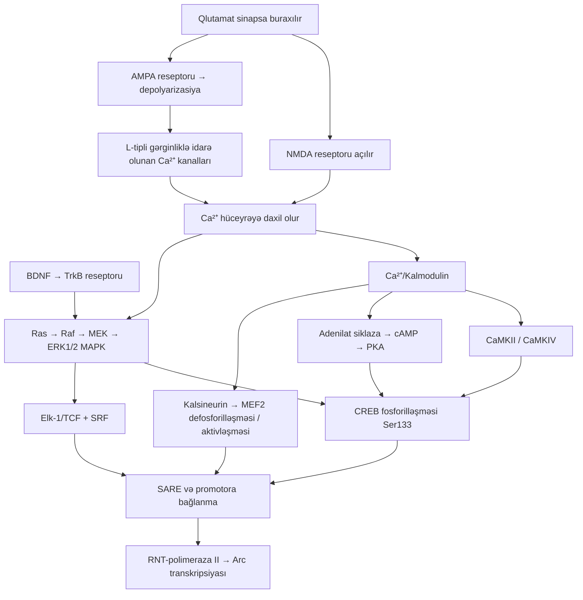

# Arc geni (Arc/Arg3.1): yaddaşı daşıyan “əhliləşdirilmiş virus”

> **Fənn:** Molekulyar biotexnologiya / molekulyar genetika
> **Mövzu növü:** Fərdi fəaliyyət (sərbəst iş)
> **Açar sözlər:** Arc, Arg3.1, ani erkən gen, sinaptik plastiklik, LTP, LTD, AMPA reseptoru, lokal translyasiya, retrotranspozon, Gag zülalı, virusabənzər kapsid, molekulyar domestikasiya, engram

---

## Mündəricat

0. [Bu işi necə oxumaq lazımdır](#0-bu-işi-necə-oxumaq-lazımdır)
1. [Giriş: niyə məhz Arc?](#1-giriş-niyə-məhz-arc)
2. [Əsas anlayışlar (izahlı baza)](#2-əsas-anlayışlar-izahlı-baza)
3. [Kəşf tarixi və adlandırma](#3-kəşf-tarixi-və-adlandırma)
4. [Genin quruluşu: DNT səviyyəsində Arc](#4-genin-quruluşu-dnt-səviyyəsində-arc)
5. [Transkripsiyanın tənzimlənməsi: siqnal sinapsdan nüvəyə](#5-transkripsiyanın-tənzimlənməsi-siqnal-sinapsdan-nüvəyə)
6. [Arc mRNT-sinin taleyi: daşınma, lokal translyasiya, parçalanma](#6-arc-mrnt-sinin-taleyi-daşınma-lokal-translyasiya-parçalanma)
7. [Arc zülalının quruluşu](#7-arc-zülalının-quruluşu)
8. [Translyasiyadan sonrakı modifikasiyalar və zülalın ömrü](#8-translyasiyadan-sonrakı-modifikasiyalar-və-zülalın-ömrü)
9. [Arc zülalının funksiyaları](#9-arc-zülalının-funksiyaları)
10. [Arc və yaddaş: heyvan təcrübələrinin sübutları](#10-arc-və-yaddaş-heyvan-təcrübələrinin-sübutları)
11. [Virusabənzər kapsid və hüceyrələrarası RNT daşınması](#11-virusabənzər-kapsid-və-hüceyrələrarası-rnt-daşınması)
12. [Təkamül: retrotranspozondan yaddaş geninə](#12-təkamül-retrotranspozondan-yaddaş-geninə)
13. [Tibbi əhəmiyyəti](#13-tibbi-əhəmiyyəti)
14. [Molekulyar biotexnologiya baxımından Arc: metodlar və tətbiqlər](#14-molekulyar-biotexnologiya-baxımından-arc-metodlar-və-tətbiqlər)
15. [Açıq suallar və elmi mübahisələr](#15-açıq-suallar-və-elmi-mübahisələr)
16. [Nəticə](#16-nəticə)
17. [Terminlər lüğəti](#17-terminlər-lüğəti)
18. [Özünüyoxlama sualları](#18-özünüyoxlama-sualları)
19. [İstinadlar](#19-istinadlar)

---

## 0. Bu işi necə oxumaq lazımdır

- Hər bölmədə əvvəl **əsas fikir**, sonra **mexanizm**, sonra **sübut (hansı təcrübə ilə bilinir)** verilir.
- 💡 **İzah** qutuları — elmi termin və ya fikrin sadə dildə açıqlamasıdır.
- 🔬 **Təcrübə** qutuları — nəticənin hansı eksperimentlə əldə olunduğunu göstərir.
- ⚠️ **Diqqət** qutuları — tez-tez edilən yanlış anlamaları və elmi mübahisələri qeyd edir.
- Mötərizədəki rəqəmlər, məsələn **[12]**, sonda verilmiş istinadlar siyahısına uyğundur.

---

## 1. Giriş: niyə məhz Arc?

Yaddaşın ən böyük sirrlərindən biri budur: **sinapsdakı zülallar bir neçə saatdan bir neçə günə qədər yaşayır, amma xatirələr onilliklərlə qala bilir.** Deməli, yaddaşın uzunmüddətli olması üçün neyron müəyyən anda **yeni genləri işə salmalı, yeni zülallar sintez etməli** və bu zülalları **dəqiq lazım olan sinapsa** çatdırmalıdır.

Arc geni bu prosesin tam mərkəzində dayanır və bir neçə səbəbə görə molekulyar biologiyada “model gen” sayılır:

| Xüsusiyyət | Niyə vacibdir |
|---|---|
| **Ani erkən gendir** | Neyron aktivləşən kimi dəqiqələr içində transkripsiya olunur — gen ekspressiyasının sürətli tənzimlənməsinin klassik nümunəsidir |
| **mRNT-si dendritə daşınır** | Lokal translyasiyanın ən yaxşı öyrənilmiş nümunələrindən biridir |
| **mRNT-si NMD hədəfidir** | Translyasiyanın “bir dəfəlik” olmasını təmin edən nadir mexanizm |
| **Sinaptik gücü həm artırır, həm azaldır** | LTP konsolidasiyası, LTD, homeostatik miqyaslama — hamısında iştirak edir |
| **Yaddaş konsolidasiyası üçün zəruridir** | Knockout siçanlarda uzunmüddətli yaddaş yoxdur |
| **Retrotranspozondan törəyib** | Molekulyar domestikasiyanın ən parlaq nümunələrindən biri |
| **Virusabənzər kapsid qurur** | Neyronlar arası RNT daşınmasının yeni mexanizmi |
| **Biotexnoloji alət kimi istifadə olunur** | Aktiv neyronları işarələmək (engram), promotor-reporter sistemləri, potensial RNT daşıyıcıları |

> 💡 **İzah — “yaddaşın molekulyar problemi”.** Zülallar daim yenilənir (zülal “dövriyyəsi”, *turnover*). Ona görə yaddaş sadəcə “bir zülalın qalması” ola bilməz. Yaddaş — **sinapsların gücündə və strukturunda** davamlı dəyişiklikdir və bu dəyişikliyi saxlamaq üçün neyron gen ekspressiyasını dəyişməlidir. Arc məhz bu “gen ekspressiyası → sinaptik dəyişiklik” keçidinin açar molekuludur.

---

## 2. Əsas anlayışlar (izahlı baza)

Arc-ı başa düşmək üçün əvvəlcə bir neçə anlayışı aydınlaşdıraq.

### 2.1. Sinaps və sinaptik güc

Neyronlar bir-biri ilə **sinaps** adlanan əlaqə nöqtələrində ünsiyyət qurur. Beyində əsas oyadıcı (həyəcanlandırıcı) neyrotransmitter **qlutamatdır**. Qlutamat postsinaptik membranda iki əsas reseptor tipinə bağlanır:

- **AMPA reseptorları** — Na⁺ ionlarını keçirir, sürətli elektrik cavabı yaradır. **Sinapsın “gücü” əsasən membrandakı AMPA reseptorlarının sayı ilə müəyyən olunur.**
- **NMDA reseptorları** — “koinsidens (üst-üstə düşmə) detektoru”dur: yalnız həm qlutamat bağlandıqda, həm də membran kifayət qədər depolyarizasiya olunduqda (Mg²⁺ bloku çıxdıqda) açılır və **Ca²⁺** keçirir. Ca²⁺ isə plastikliyi başladan əsas siqnaldır.

### 2.2. Sinaptik plastiklik

> 💡 **İzah.** Plastiklik — sinapsın fəaliyyətə görə gücünü dəyişmə qabiliyyətidir. “Birlikdə aktivləşən neyronlar bir-birinə bağlanır” (Hebb qaydası).

- **LTP (long-term potentiation, uzunmüddətli potensiasiya)** — sinapsın davamlı güclənməsi. AMPA reseptorları membrana əlavə olunur, dendritik tikan (spine) böyüyür.
  - **Erkən LTP (E-LTP)** — 1–3 saat davam edir, mövcud zülalların modifikasiyası ilə baş verir, **yeni zülal sintezi tələb etmir**.
  - **Gec LTP (L-LTP)** — saatlarla, günlərlə qalır, **yeni gen transkripsiyası və zülal sintezi tələb edir**. Arc məhz burada lazımdır.
- **LTD (long-term depression, uzunmüddətli depressiya)** — sinapsın davamlı zəifləməsi; AMPA reseptorları endositozla membrandan çıxarılır.
- **Homeostatik miqyaslama (synaptic scaling)** — neyronun ümumi aktivliyi çox artdıqda bütün sinapsları mütənasib zəiflətməsi (və əksinə). Bu, şəbəkəni “doyma”dan və ya “susmadan” qoruyur.

### 2.3. Yaddaş konsolidasiyası

Öyrənmədən sonra yaddaş əvvəlcə **labil (asanlıqla pozulan)** formada olur. Bir neçə saat ərzində o **konsolidasiya olunur** — yəni stabil, uzunmüddətli formaya keçir. Konsolidasiya **zülal sintezi inhibitorları** (məs., anizomisin) ilə bloklana bilir. Bu, uzunmüddətli yaddaşın yeni zülallardan asılı olduğunu göstərir.

### 2.4. Ani erkən genlər (IEG)

> 💡 **İzah.** Hüceyrəyə siqnal gəldikdə ilk “oyanan” genlərdir. “Ani” — çünki onların transkripsiyası üçün **əvvəlcədən yeni zülal sintez olunmasına ehtiyac yoxdur**; hüceyrədə artıq mövcud olan transkripsiya faktorları fosforilləşərək geni dərhal işə salır. Klassik IEG-lər: *c-fos*, *Egr1 (Zif268)*, *Npas4* və **Arc**.

IEG-lər iki qrupa bölünür:
1. **Transkripsiya faktoru kodlayanlar** (c-Fos, Egr1, Npas4) — onlar başqa genləri işə salır (ikinci dalğa).
2. **“Effektor” IEG-lər** (Arc, Homer1a, Narp) — birbaşa sinapsda iş görən zülallar kodlayır.

**Arc effektor IEG-dir** — yəni o, başqa genləri idarə etmək üçün deyil, birbaşa sinapsı dəyişmək üçün sintez olunur (baxmayaraq ki, nüvədə də rolu var — bax §9.5).

### 2.5. Retrotranspozon və Gag zülalı

- **Transpozon** — genomda yerini dəyişə bilən DNT ardıcıllığı (“tullanan gen”, Barbara McClintock-un kəşfi).
- **Retrotranspozon** — “kopyala-yapışdır” mexanizmi ilə hərəkət edir: DNT → RNT → (tərs transkriptaza ilə) DNT → genomun yeni yerinə inteqrasiya.
- **LTR-retrotranspozonlar** (məs., **Ty3/gypsy** ailəsi) quruluşca retroviruslara çox yaxındır: hər ikisində **gag** və **pol** genləri var. Retroviruslar əlavə olaraq **env** (örtük) geni qazanaraq hüceyrədən çıxıb başqa hüceyrəni yoluxdurma qabiliyyəti əldə ediblər.
- **Gag zülalı** — retrovirus/retrotranspozonun **kapsidini (zülal qabığını)** quran struktur zülaldır. HIV-də Gag parçalanaraq **MA (matriks), CA (kapsid), NC (nukleokapsid)** zülallarını əmələ gətirir. CA domeni iki hissədən — **N-lob (NTD)** və **C-lob (CTD)** — ibarətdir.

> 💡 **Niyə vacibdir?** Arc zülalının C-terminal hissəsi məhz **HIV-in CA domeninə struktur cəhətdən bənzəyir**. Bu oxşarlıq təsadüfi deyil — ortaq təkamül mənşəyini göstərir (bax §12).

---

## 3. Kəşf tarixi və adlandırma

### 3.1. 1995: iki laboratoriya, bir gen

| Laboratoriya | Məqalə | Verilən ad | Mənası |
|---|---|---|---|
| Paul Worley qrupu (Johns Hopkins) | **Lyford və b., 1995, *Neuron*** [1] | **Arc** | *activity-regulated cytoskeleton-associated protein* — fəaliyyətlə tənzimlənən, hüceyrə skeleti ilə əlaqəli zülal |
| Dietmar Kuhl qrupu (Almaniya) | **Link və b., 1995, *PNAS*** [2] | **Arg3.1** | *activity-regulated gene 3.1* |

Hər iki qrup **neyronlarda fəaliyyətdən asılı olaraq ekspressiyası artan genləri** axtarırdı (diferensial skrininq metodları ilə — məs., qıcolma və ya yüksək tezlikli stimulyasiyadan sonra beyin toxumasından cDNT kitabxanaları müqayisə edilirdi). Buna görə ədəbiyyatda gen çox vaxt **Arc/Arg3.1** kimi yazılır.

> ⚠️ **Diqqət.** “Cytoskeleton-associated” adı tarixi səbəbdəndir: ilk təcrübələrdə Arc zülalı aktin hüceyrə skeleti fraksiyası ilə birlikdə çökürdü. Sonradan aydın oldu ki, Arc-ın əsas funksiyası hüceyrə skeleti zülalı olmaq deyil, endositoz və sinaptik plastiklikdir. Ad isə qaldı.

### 3.2. Tarixi xronologiya

| İl | Hadisə | İstinad |
|---|---|---|
| 1995 | Arc/Arg3.1 kəşfi | [1, 2] |
| 1998 | Arc mRNT-sinin **aktivləşmiş dendritik zonaya** toplandığı göstərildi | [5] |
| 1999 | **catFISH** metodu — Arc ilə aktiv neyron ansambllarının xəritələnməsi | [3] |
| 2000 | Arc antisens ilə LTP saxlanması və yaddaş konsolidasiyasının pozulması | [4] |
| 2001 | mRNT-nin aktiv sinapslara yönəlməsinin NMDA reseptorundan asılılığı | [6] |
| 2006 | Arc-ın **endofilin/dinamin** ilə AMPA reseptoru endositozu; **homeostatik miqyaslama**; **knockout siçanlar** (Plath) | [11, 10, 12] |
| 2006 | Bioinformatika: Arc-ın **Gag-abənzər** zülal olduğu irəli sürüldü | [25] |
| 2007 | Arc mRNT-sinin **NMD** ilə tənzimlənməsi | [7] |
| 2008 | Arc-ın **mGluR-LTD**-də rolu, **FMRP** ilə əlaqə | [14, 15] |
| 2009 | Arc promotorunda **SARE** enhanseri | [8] |
| 2010 | **UBE3A–Arc** əlaqəsi (Angelman) | [17] |
| 2011 | Arc və **β-amiloid** (Alzheimer) | [20] |
| 2012 | **Tərs sinaptik etiketləmə** (Arc–CaMKIIβ) | [16] |
| 2013 | Nüvə Arc-ı və GluA1 transkripsiyası | [21] |
| 2014 | Şizofreniyada de novo mutasiyaların **ARC kompleksində** toplanması | [29, 30] |
| 2015 | Arc CA domeninin kristal quruluşu, HIV CA ilə oxşarlıq | [24] |
| 2018 | **Arc virusabənzər kapsid qurur və mRNT daşıyır** (məməli və milçək) | [26, 27] |
| 2019 | CaMKII fosforilləşməsinin Arc oliqomerləşməsini tənzimləməsi | [38] |
| 2020 | Milçək Arc kapsidlərinin **cryo-EM** quruluşu | [28] |
| 2021 | Oxşar Gag-abənzər məməli zülalı **PEG10** ilə mRNT daşıma platforması (SEND) | [34] |

---

## 4. Genin quruluşu: DNT səviyyəsində Arc

### 4.1. Əsas göstəricilər

| Parametr | İnsan (*ARC*) | Siçan/siçovul (*Arc*) |
|---|---|---|
| Xromosom yeri | **8q24.3** | Siçan: 15-ci xromosom; siçovul: 7-ci xromosom |
| Genin ölçüsü | təxminən 3,5 kb (çox kompakt) | oxşar |
| Ekzon sayı | **3** | 3 |
| Zülalın uzunluğu | **396 amin turşusu** | 396 amin turşusu |
| Molekulyar kütlə | ~45 kDa (gel elektroforezində ~50–55 kDa kimi görünür) | eyni |
| Konservativlik | Məməlilər arasında çox yüksək | — |

### 4.2. Qeyri-adi gen arxitekturası

Arc geninin quruluşunda çox maraqlı bir xüsusiyyət var:

```
 5'                                                                        3'
 ──[SARE enhanser ~7 kb yuxarıda]────[Promotor]──[EKZON 1: bütün kodlayan ardıcıllıq + STOP]──intron──[ekzon 2]──intron──[ekzon 3]── poli(A)
                                                     |<------ ORF (396 aa) ------>|          |<---- hamısı 3'UTR-dədir ---->|
```

**Bütün zülal-kodlayan ardıcıllıq birinci ekzonda yerləşir**, iki intron isə **stop-kodondan sonra, 3'-translyasiya olunmayan sahədə (3'UTR)** yerləşir.

> 💡 **İzah — niyə bu qəribədir?** Adətən intronlar kodlayan hissənin içində olur. Stop-kodondan aşağıda intron olması hüceyrənin **“nonsense-mediated decay” (NMD)** nəzarət sistemini işə salır: splaysinqdən sonra mRNT üzərində qalan **ekzon-qovşaq kompleksləri (EJC)** ribosoma “bu mRNT-də vaxtından əvvəl stop-kodon var” siqnalı verir və mRNT birinci translyasiya raundundan sonra parçalanır. Arc üçün bu “səhv” deyil — **xüsusi tənzimləmə mexanizmidir**: hər mRNT molekulu dendritdə **məhdud sayda** zülal verir, sonra məhv olur. Beləliklə Arc zülalının miqdarı və yeri çox dəqiq idarə olunur [7]. Ətraflı §6.3-də.

### 4.3. Tənzimləyici elementlər

- **Promotor** — TATA-qutusu və CRE (cAMP-cavab elementi), SRE (serum-cavab elementi) kimi elementlər.
- **SARE (Synaptic Activity-Responsive Element)** — transkripsiya başlanğıcından təxminən **7 kb yuxarıda** yerləşən, ~100 nukleotidlik güclü enhanser. Onun içində **üç əsas transkripsiya faktoru üçün bağlanma yerləri** bir-birinə yaxın düzülüb: **CREB, MEF2 və SRF** [8].
- Əlavə distal enhanserlər (beyin bölgəsindən asılı olaraq istifadə olunan).

> 🔬 **Təcrübə (Kawashima və b., 2009) [8].** Arc promotorunun müxtəlif uzunluqlu fraqmentləri reporter genə (lusiferaza/GFP) qoşularaq neyronlara köçürülüb. Yalnız ~7 kb yuxarıdakı sahəni ehtiva edən konstrukt sinaptik aktivliyə güclü cavab verib. Bu sahədə CREB, MEF2 və SRF bağlanma yerlərini mutasiya etdikdə cavab itib. Sonradan bu element **sintetik promotor E-SARE** yaratmaq üçün istifadə edilib (bax §14).

---

## 5. Transkripsiyanın tənzimlənməsi: siqnal sinapsdan nüvəyə

### 5.1. Siqnal yolu addım-addım



**Mətnlə izah:**

1. **Qlutamatın buraxılması.** Presinaptik neyron qlutamat buraxır.
2. **Ca²⁺ girişi.** NMDA reseptorları (və L-tipli Ca²⁺ kanalları) vasitəsilə hüceyrəyə Ca²⁺ daxil olur. Arc induksiyası üçün NMDA reseptor aktivliyi əsas şərtdir — NMDA antaqonisti (məs., MK-801, APV) Arc induksiyasını bloklayır.
3. **Kinaz kaskadları.** Ca²⁺ kalmodulinə bağlanır və bir neçə kinazı aktivləşdirir:
   - **CaMKII/CaMKIV** (Ca²⁺/kalmodulin-asılı kinazalar)
   - **PKA** (cAMP-asılı zülal kinaza A)
   - **ERK1/2 (MAPK)** — Arc induksiyası üçün ən kritik yollardan biri; MEK inhibitorları Arc transkripsiyasını güclü şəkildə bloklayır [45].
4. **Transkripsiya faktorlarının aktivləşməsi:**
   - **CREB** — Ser133-də fosforilləşir, koaktivator CBP/p300-ü cəlb edir.
   - **SRF + TCF (Elk-1)** — ERK ilə aktivləşir, SRE-yə bağlanır.
   - **MEF2** — kalsineurin (Ca²⁺-asılı fosfataza) vasitəsilə aktivləşir.
5. **Transkripsiya.** Bu faktorlar SARE və promotorda birləşərək RNT-polimeraza II-ni aktivləşdirir.

> 💡 **İzah — “paused polymerase” (dayandırılmış polimeraza).** Arc kimi IEG-lərdə RNT-polimeraza II hətta neyron sakit olanda belə promotorun yaxınlığında “hazır vəziyyətdə dayanmış” olur. Siqnal gəldikdə polimeraza sadəcə “buraxılır”. Bu, Arc transkripsiyasının niyə **1–2 dəqiqə ərzində** başladığını izah edir. Bundan əlavə, neyron fəaliyyəti zamanı Arc kimi IEG-lərin promotorlarında DNT-də ikiqat zəncir qırılmaları (topoizomeraza IIβ vasitəsilə) yaranaraq topoloji maneələri aradan qaldırdığı da göstərilib — bu, sürətli transkripsiyanın əlavə mexanizmidir.

### 5.2. Arc-ı induksiya edən stimullar

| Stimul | Nəticə |
|---|---|
| **Yeni mühitin kəşfi**, məkan öyrənməsi | Hipokampda seçilmiş neyronlarda Arc artır [3] |
| **LTP-induksiyaedici yüksək tezlikli stimulyasiya** | Dentat girusda güclü Arc induksiyası [5] |
| **BDNF** | ERK vasitəsilə Arc sintezi; BDNF-LTP üçün Arc lazımdır [46] |
| **mGluR aktivləşməsi (DHPG)** | Mövcud mRNT-dən sürətli Arc translyasiyası [14, 15] |
| **Qıcolma (konvulsiya)** | Bütün beyində kəskin Arc artımı (ilk kəşflərdə istifadə olunub) |
| **Görmə təcrübəsi** | Görmə qabığında Arc induksiyası [23] |
| **Narkotik maddələr (kokain, amfetamin)** | Striatumda Arc induksiyası |

> ⚠️ **Maraqlı paradoks.** Arc transkripsiyası güclü AMPA reseptor aktivliyi ilə **zəifləyə** bilir [47]. Yəni sinaps artıq güclüdürsə, Arc az sintez olunur — bu, Arc-ın sinapsı zəiflədən funksiyası ilə birlikdə **mənfi əks-əlaqə halqası** yaradır.

### 5.3. Zaman dinamikası

| Hadisə | Təxmini vaxt |
|---|---|
| Transkripsiyanın başlanması | 1–2 dəqiqə |
| Nüvədə Arc RNT “ocaqları” (transkripsiya yerləri) görünür | ~5 dəqiqə |
| mRNT sitoplazmaya keçir | ~20–30 dəqiqə |
| mRNT-nin pik səviyyəsi | ~30–60 dəqiqə |
| Arc zülalının pik səviyyəsi | ~1–2 saat |
| Bazal səviyyəyə qayıdış | bir neçə saat |
| mRNT və zülalın yarımparçalanma dövrü | hər biri təxminən 1 saatdan az (mənbəyə görə dəyişir) [54] |

Məhz bu **nüvə → sitoplazma** zaman fərqi **catFISH** metodunun əsasını təşkil edir (§14.2).

---

## 6. Arc mRNT-sinin taleyi: daşınma, lokal translyasiya, parçalanma

Arc mRNT-si molekulyar biologiyada **mRNT lokalizasiyasının** ən yaxşı nümunələrindən biridir.

### 6.1. Dendritlərə daşınma

1. Nüvədə splaysinq olunan mRNT **ribonukleoprotein (RNP) qranullarına** yığılır.
2. 3'UTR-dəki **dendritik hədəfləmə elementi (DTE)** — RNT-bağlayıcı zülallar tərəfindən tanınır.
3. RNP qranulu **mikrotubullar boyunca kinezin motor zülalları** ilə dendritə daşınır.
4. Daşınma zamanı translyasiya **susdurulmuş** olur (translyasiya repressorları, o cümlədən FMRP iştirak edir).

### 6.2. Aktiv sinapsda toplanma — əsas sübut

> 🔬 **Təcrübə (Steward və b., 1998) [5].** Siçovulların hipokampında **perforant yolun** yalnız medial hissəsi stimullaşdırılıb. Bu lif dentat girusun dendritlərinin yalnız **orta molekulyar qatında** sinaps yaradır. Nəticə: yeni sintez olunmuş Arc mRNT-si **məhz bu qatda** toplanıb, dendritin başqa hissələrində isə yox. Yəni mRNT “ünvanlı” şəkildə aktivləşmiş sinapsa gedir.
>
> **Davamı (Steward & Worley, 2001) [6]:** bu hədəfli toplanma **NMDA reseptor aktivliyi tələb edir** — NMDA blokatoru verildikdə mRNT dendritdə bərabər paylanıb.

Sonrakı işlər göstərdi ki, aktiv bölgədə toplanma qismən **lokal parçalanma** hesabına baş verir: aktiv sinapsda mRNT translyasiya olunur və sonra parçalanır, bu isə mRNT-nin paylanma profilini dəyişir [49]. 2018-ci ildə endogen Arc mRNT-sini canlı neyronlarda real vaxtda izləməyə imkan verən transgen siçan modeli yaradılıb [50].

### 6.3. “Bir dəfəlik” translyasiya: NMD mexanizmi

```
Nüvədə splaysinq:
  [ORF ... STOP] ─EJC─ [3'UTR ekzon 2] ─EJC─ [3'UTR ekzon 3] ─ AAAA
                   ↑                    ↑
         stop-kodondan aşağıda qalan ekzon-qovşaq kompleksləri

Dendritdə birinci (pioner) translyasiya:
  Ribosom STOP kodona çatır → aşağıda EJC görür → UPF1 aktivləşir
  → mRNT parçalanır (NMD)
```

> 🔬 **Təcrübə (Giorgi və b., 2007, *Cell*) [7].** EJC-nin əsas komponenti **eIF4AIII**-ün səviyyəsini RNT interferensiyası ilə azaltdıqda, neyronlarda Arc mRNT-si və zülalı artıb, sinaptik güc dəyişib. Bu, NMD-nin Arc miqdarını məhdudlaşdıran **fizioloji tənzimləyici** olduğunu göstərdi.

> 💡 **Bunun mənası.** Neyron bir sinapsda Arc lazım olduqda mRNT həmin yerdə qısa müddət ərzində zülal verir və məhv olur. Bu, Arc zülalının **həm zaman, həm də məkan baxımından məhdud** olmasını təmin edir — əks halda Arc bütün sinapsları zəiflədə bilərdi.

### 6.4. Translyasiyanın tənzimlənməsi

- **mGluR-asılı translyasiya:** metabotrop qlutamat reseptorlarının (mGluR1/5) aktivləşməsi artıq dendritdə olan Arc mRNT-sinin **dəqiqələr ərzində** translyasiyasına səbəb olur. Bunu **eEF2** (elongasiya faktoru 2) və **FMRP** idarə edir [14].
- **FMRP** (Fragile X zülalı) Arc mRNT-sinə bağlanaraq translyasiyanı **basqılayır**. FMRP olmadıqda (Fragile X sindromu) Arc bazal səviyyədə artıq sintez olunur [14].
- **5'UTR-də IRES** (daxili ribosom giriş sahəsi) olduğu da bildirilib ki, bu da kap-asılı olmayan translyasiyaya imkan verir.
- **BDNF → mTOR** yolu da Arc translyasiyasını gücləndirir.

---

## 7. Arc zülalının quruluşu

### 7.1. Domen arxitekturası

```
 N                                                                                          C
 1        ~25        ~140           ~200   ~210                   ~280                ~370  396
 |--------|-----------|--------------|-------|---------------------|--------------------|---|
 |   N-terminal domen (NTD)          | Linker|        C-terminal domen (CTD) = "kapsid domeni"
 |  qıvrıq-qıvrım (coiled-coil)      |       |   N-lob (CA-NTD-yə bənzər)  |  C-lob (CA-CTD-yə bənzər)
 |  müsbət yüklü, membran bağlayır   |       |   hidrofob cib: TARPγ2,     |  oliqomerləşmə
 |  oliqomerləşmə, palmitoilləşmə    |       |   CaMKII, GluN2A bağlanır   |
 |  endofilin bağlanma sahəsi        | dinamin bağlanma sahəsi
```

*(Sərhədlər təxminidir; ədəbiyyatda bir neçə amin turşusu fərqi ola bilər.)*

| Domen | Quruluş | Funksiya |
|---|---|---|
| **NTD** (təxminən 1–140) | α-spirallardan ibarət qıvrıq-qıvrım (coiled-coil); müsbət yüklü | Membran lipidlərinə bağlanma, **oliqomerləşmə (öz-özünə birləşmə)**, endofilin-3 ilə qarşılıqlı əlaqə; kapsid qurulması üçün NTD-dəki spiral motiv vacibdir [37] |
| **Linker** | Elastik, strukturu az olan hissə | Dinamin-2 bağlanması, molekula hərəkətlilik verir |
| **CTD (kapsid domeni)** (təxminən 206–364) | İki α-spiral lob: N-lob və C-lob | **Retrovirus Gag-ın CA domeninə struktur homoloqdur** [24]; N-lobdakı hidrofob cib sinaptik zülalların qısa peptidlərini bağlayır |
| **C-terminal quyruq** | Qısa, nizamsız | — |

### 7.2. Struktur biologiyası sübutları

> 🔬 **Zhang və b., 2015, *Neuron* [24].** Rentgen kristalloqrafiyası ilə Arc-ın CTD-sinin quruluşu müəyyən olundu. İki lobun hər biri retrovirus (HIV-1) kapsid zülalının (CA) müvafiq lobu ilə **eyni qatlanma (fold)** göstərdi. N-lobdakı hidrofob cib **TARPγ2 (stargazin)** — AMPA reseptorunun köməkçi alt vahidi — və **CaMKII**, **GluN2A** peptidlərini bağlayır. Bu, Arc-ın sinapsda necə “lövbər saldığını” izah edir.

> 🔬 **Hallin və b., 2018 [37].** Tam uzunluqlu Arc-ın məhlulda quruluşu (SAXS və digər biofiziki üsullarla) — NTD ilə CTD arasında elastik birləşmə olduğu, molekulun çevik olduğu göstərildi.

> 🔬 **Erlendsson və b., 2020 [28].** Cryo-EM ilə **milçək dArc1 və dArc2** kapsidlərinin quruluşu həll olundu. Kapsidlər **ikosaedrik simmetriyalı** (T=4 tipli), diametri ~37 nm olan qablardır və retrovirus kapsidlərinə çox bənzəyir. Kapsidin çıxıntılarında (“spike”-larda) RNT ilə qarşılıqlı əlaqədə ola biləcək ardıcıllıqlar da var.

> ⚠️ **Diqqət.** Məməli Arc-ın kapsidləri milçək kapsidləri qədər nizamlı deyil və onların yüksək ayırdetməli quruluşu milçəkdəki qədər tam həll olunmayıb. Buna görə “Arc kapsidinin quruluşu atom səviyyəsində məlumdur” ifadəsi yalnız **milçək Arc-ı** üçün doğrudur.

### 7.3. Oliqomerləşmə — funksiyanın açarı

Arc monomer, dimer, kiçik oliqomerlər və böyük kapsidlər şəklində mövcud ola bilir. **Hansı formada olması funksiyasını müəyyən edir**:

- **Kiçik oliqomerlər** → endositoz, AMPA reseptor çıxarılması.
- **Böyük kapsidlər** → RNT qablaşdırma və hüceyrədən xaric olma.

> 🔬 **Zhang və b., 2019, *Mol Cell* [38].** CaMKII Arc-ı kapsid domenində (Ser260) fosforilləşdirir; bu fosforilləşmə **yüksək səviyyəli oliqomerləşməni pozur**. Fosforilləşməni təqlid edən mutant Arc yaddaş formalaşdırmada qüsurlu olub. Yəni oliqomerləşmə Arc-ın sinaptik funksiyası üçün də vacibdir.

---

## 8. Translyasiyadan sonrakı modifikasiyalar və zülalın ömrü

Arc zülalı qısaömürlüdür və onun səviyyəsi bir çox modifikasiya ilə idarə olunur:

| Modifikasiya | Ferment / mexanizm | Nəticə | İstinad |
|---|---|---|---|
| **Ubikvitinləşmə** | **RNF216/Triad3A** (K268, K269 lizinlərində) | Proteasomda parçalanma; Triad3A olmadıqda Arc toplanır, AMPA reseptorları azalır | [19] |
| **Ubikvitinləşmə** (mübahisəli) | **UBE3A (E6AP)** | Angelman sindromu ilə əlaqə; birbaşa substrat olub-olmadığı mübahisəlidir | [17, 18] |
| **Fosforilləşmə** | **CaMKII** (Ser260) | Oliqomerləşməni azaldır | [38] |
| **Fosforilləşmə** | GSK3, ERK | Stabillik və funksiyaya təsir | — |
| **Asetilləşmə** | Lizin asetiltransferazaları | Ubikvitinləşmə ilə rəqabət aparıb Arc-ı stabilləşdirə bilər (ilkin məlumat) | — |
| **Palmitoilləşmə** | NTD-dəki sisteinlər | Membrana bağlanma, sinaptik depressiyada rol | [40] |
| **SUMOilləşmə** | SUMO1 | LTP konsolidasiyasında drebrin A ilə qarşılıqlı əlaqə | — |

> 💡 **İzah — niyə Arc tez parçalanmalıdır?** Arc sinapsı zəiflədir. Əgər o uzun yaşasaydı, bütün sinapsları zəiflədərək öyrənməni pozardı. Tez sintez — tez parçalanma Arc-ı “dəqiq zamanlı, qısa ömürlü siqnal”a çevirir. Bu, molekulyar biologiyada **“nəbz” (pulse) siqnal** prinsipinin yaxşı nümunəsidir.

---

## 9. Arc zülalının funksiyaları

Arc ilk baxışda **ziddiyyətli** funksiyalara malikdir: həm sinapsı zəiflədir (LTD, miqyaslama), həm də LTP-nin konsolidasiyası üçün zəruridir. Bu ziddiyyətin həlli — **yer, zaman və oliqomer formasındadır**.

### 9.1. AMPA reseptorlarının endositozu (əsas mexanizm)

```
Arc ──bağlanır──► Endofilin-2/3 ──► Dinamin-2
  │                                    │
  └──► Klatrinlə örtülmüş çuxur ◄──────┘
              │
              ▼
   AMPA reseptoru (GluA1/GluA2) membrandan hüceyrə daxilinə çəkilir
              │
              ▼
     Sinaptik cavab azalır (sinaps zəifləyir)
```

> 🔬 **Chowdhury və b., 2006, *Neuron* [11].** Arc endofilin-2/3 və dinamin-2 ilə birbaşa bağlanır. Arc-ı neyronlarda artıq ekspressiya etdikdə AMPA reseptorlarının endositoz sürəti artıb və səthdəki reseptorlar azalıb. Endofilin və ya dinamin bağlanma sahələri silinmiş Arc mutantları bu təsiri göstərməyib.

Bundan əlavə, Arc AP-2 adaptor kompleksi ilə də qarşılıqlı əlaqədə olur və klatrin-asılı endositozu birbaşa gücləndirir.

### 9.2. Homeostatik miqyaslama

> 🔬 **Shepherd və b., 2006, *Neuron* [10].** Neyron kulturasında aktivliyi uzun müddət **artırdıqda** (bikukullin ilə) normal neyronlar bütün sinapslarda AMPA reseptorlarını azaldır; aktivliyi **bloklayanda** (TTX ilə) isə artırır. **Arc knockout neyronlarda bu miqyaslama baş vermədi** — reseptor səviyyəsi aktivlik dəyişikliyinə cavab vermədi. Arc-ı artıq ekspressiya etmək isə AMPA cərəyanlarını azaltdı.

Canlı heyvanlarda — siçanların görmə qabığında — görmə təcrübəsindən asılı homeostatik plastiklik üçün də Arc lazım olduğu göstərilib [53].

### 9.3. mGluR-asılı LTD

> 🔬 **Park və b., 2008; Waung və b., 2008, *Neuron* [14, 15].** mGluR agonisti DHPG ilə LTD induksiya etdikdə, artıq dendritdə olan Arc mRNT-si **dəqiqələr ərzində** translyasiya olunur. Arc knockout siçanlarda və ya Arc translyasiyası bloklandıqda **mGluR-LTD baş vermir**. Bu LTD-nin davamlılığı Arc-ın AMPA endositoz sürətini uzun müddət yüksək saxlamasından asılıdır.

### 9.4. Tərs sinaptik etiketləmə (inverse synaptic tagging)

Bu, Arc-ın “paradoksunu” ən zərif şəkildə izah edən mexanizmdir.

> 🔬 **Okuno və b., 2012, *Cell* [16].**
> 1. Neyron güclü stimulyasiya alır → Arc sintez olunur.
> 2. Arc zülalı **CaMKIIβ-nin aktiv olmayan (Ca²⁺/kalmodulin bağlanmamış) formasına** bağlanır.
> 3. Aktiv olmayan CaMKIIβ isə məhz **stimullaşdırılmamış (zəif) sinapslarda** olur; aktiv sinapslarda CaMKIIβ Ca²⁺/kalmodulin bağladığı üçün Arc-a bağlanmır.
> 4. Nəticədə Arc **zəif sinapslarda** toplanır və onlardan AMPA reseptorlarını (GluA1) çıxarır.

```
 Güclü (stimullaşdırılmış) sinaps:  CaMKIIβ + Ca²⁺/CaM  → Arc bağlanmır → sinaps güclü qalır  ↑↑
 Zəif (stimullaşdırılmamış) sinaps: CaMKIIβ (inaktiv)    → Arc bağlanır  → AMPA çıxarılır     ↓↓
                                                 ⇒  Kontrast artır (siqnal/küy nisbəti)
```

> 💡 **Analogiya.** Fotoşəkildə kontrastı artırmaq kimi: işıqlı yerlər daha işıqlı, qaranlıq yerlər daha qaranlıq olur. Beləliklə öyrənmə ilə əlaqəli sinapslar seçilib qabarıq olur, əlaqəsiz sinapslar isə “silinir”. **Bu, yaddaşın spesifikliyini artırır.**

### 9.5. LTP konsolidasiyası və aktin hüceyrə skeleti

> 🔬 **Messaoudi və b., 2007 [13].** Canlı siçovulun dentat girusunda LTP induksiya edildikdən **2 saat sonra** belə Arc antisens oliqonukleotid yeridildikdə, artıq formalaşmış LTP **geri döndü (söndü)**. Bu zaman **kofilinin** fosforilləşməsi azaldı və dendritik tikanlarda **F-aktin** polimerləşməsi pozuldu. Aktin stabilizatoru jasplakinolid isə LTP-ni Arc antisensindən qorudu.

Nəticə: Arc **LTP-nin davam etməsi üçün** dendritik tikanın aktin skeletinin genişlənməsini və stabilləşməsini təmin edir. Arc tikanların morfologiyasını da tənzimləyir — Arc artıqlığı daha çox nazik tikanların yaranmasına səbəb olur [41].

> ⚠️ **Ziddiyyətin həlli.** Arc **eyni vaxtda**:
> - aktiv sinapslarda aktin skeletini stabilləşdirərək LTP-ni **saxlayır**;
> - zəif sinapslarda (tərs etiketləmə ilə) AMPA reseptorlarını **çıxarır**;
> - bütün neyronda həddindən artıq aktivliyə qarşı **miqyaslama** aparır.
> Yəni Arc “gücləndirici” və ya “zəiflədici” deyil — **sinaptik çəkilərin yenidən paylanmasının** tənzimləyicisidir.

### 9.6. Nüvədə Arc

Arc zülalının bir hissəsi nüvəyə keçir:
- **PML cisimcikləri** (promyelotsitar leykemiya zülalı ilə əlaqəli nüvə strukturları) ilə birləşir və **GluA1 geninin transkripsiyasını azaldır** — homeostatik plastikliyə “nüvədən” töhfə verir [21].
- **Tip60** histon asetiltransferazası ilə qarşılıqlı əlaqədə olaraq **H4K12 asetilləşməsini** dəyişir [22] — yəni Arc **epigenetik tənzimləməyə** də qatılır. Maraqlıdır ki, H4K12 asetilləşməsinin azalması yaşla bağlı yaddaş zəifləməsi ilə əlaqələndirilib.

### 9.7. Neyronlardan kənarda

Arc yalnız beyində deyil: **dendritik hüceyrələrdə** (immun sistemi hüceyrələri) Arc dəridən limfa düyünlərinə miqrasiya və T-hüceyrə aktivləşməsi üçün lazımdır [42]. Bu, Arc-ın aktin skeleti üzərindəki təsirinin ümumi bioloji rol oynadığını göstərir.

---

## 10. Arc və yaddaş: heyvan təcrübələrinin sübutları

### 10.1. Antisens oliqonukleotidlər

> 🔬 **Guzowski və b., 2000, *J Neurosci* [4].** Siçovulların hipokampına Arc antisens oliqonukleotid yeridildi (Arc zülalının sintezini blokladı). Nəticələr:
> - **LTP-nin induksiyası normal**, amma **saxlanması pozuldu** (LTP bir neçə saatdan sonra söndü).
> - Su labirintində (Morris su labirinti) **öyrənmə** baş verdi, amma 48 saat sonra yoxlanıldıqda **uzunmüddətli yaddaş** pozulmuşdu.

### 10.2. Knockout siçanlar

> 🔬 **Plath və b., 2006, *Neuron* [12].** Arc geni tamamilə silinmiş (knockout, KO) siçanlar:

| Göstərici | Arc KO nəticəsi |
|---|---|
| Ümumi beyin anatomiyası | Normal |
| Qısamüddətli yaddaş (dəqiqələr) | **Normal** |
| Uzunmüddətli yaddaş (24 saat və daha çox) | **Ciddi pozulub** — məkan yaddaşı, qorxu kondisionlaşması, dad iyrənməsi, obyekt tanıma |
| Erkən LTP | **Hətta güclənib** |
| Gec LTP | **Formalaşmır** |
| LTD | **Pozulub** |

**Əsas nəticə:** *Öyrənmə* (məlumatın qəbulu) və *konsolidasiya* (onun qalıcı hala gətirilməsi) — fərqli molekulyar mexanizmlərdir. Arc **konsolidasiya** üçün zəruridir.

> 💡 **Niyə erkən LTP güclənir?** Arc olmadıqda AMPA reseptorları endositozla çıxarılmır, ona görə sinaps qısa müddətdə daha asan güclənir. Amma bu güclənməni saxlamaq üçün lazım olan aktin stabilləşməsi və sinaptik çəkilərin yenidən paylanması olmadığı üçün LTP tez sönür. Bu, “**güclənmə ≠ yaddaş**” prinsipinin gözəl nümunəsidir.

### 10.3. Görmə qabığı və kritik dövr

> 🔬 **McCurry və b., 2010, *Nat Neurosci* [23].** Arc KO siçanlarda bir gözü bağlamaqla yaradılan **okulyar dominantlıq plastikliyi** baş vermədi — görmə qabığı təcrübəyə “immun” oldu. **Jenks və b., 2017 [52]** isə göstərdi ki, yaşlı siçanlarda Arc ekspressiyasını artırmaq **gənclik dövrünə xas plastikliyi bərpa edir**. Bu, Arc-ın beyində “kritik dövr” plastikliyinin tənzimləyicisi ola biləcəyini göstərir.

### 10.4. Yaddaşın yenidən konsolidasiyası

Xatırlanan yaddaş yenidən labil hala keçir və yenidən stabilləşdirilməlidir (*rekonsolidasiya*). Bir sıra işlərdə amigdala və hipokampda Arc-ın bloklanmasının həm konsolidasiyanı, həm də rekonsolidasiyanı pozduğu göstərilib. Bu, travma sonrası stress pozuntusu (TSSP) kimi vəziyyətlərin müalicə strategiyaları baxımından maraqlıdır.

---

## 11. Virusabənzər kapsid və hüceyrələrarası RNT daşınması

Mövzunun ən məşhur hissəsi 2018-ci ildə *Cell* jurnalının eyni nömrəsində çıxan iki məqalədir.

### 11.1. Pastuzyn və b., 2018 — məməlilərdə (Jason Shepherd laboratoriyası) [26]

```
  Neyron A (verən)                                   Neyron B (alan)
 ┌──────────────────┐                              ┌──────────────────┐
 │ Arc zülalı +     │  1. Öz-özünə birləşmə        │                  │
 │ Arc mRNT         │ ───► kapsid (~32 nm)         │                  │
 │      ⬇           │                              │                  │
 │ [Kapsid+mRNT]    │  2. Ekstrasellülar vezikul   │                  │
 │      ⬇           │     (EV) içində xaric olur   │                  │
 │   ○○○ EV ○○○  ───┼─────────────────────────────►│ 3. Endositoz     │
 └──────────────────┘                              │ 4. mRNT azad     │
                                                   │ 5. Aktivlikdən   │
                                                   │    asılı         │
                                                   │    translyasiya  │
                                                   └──────────────────┘
```

**Addım-addım sübutlar:**

1. **Filogenetik analiz:** Arc-ın Ty3/gypsy retrotranspozonlarının Gag zülalından törədiyi təsdiqləndi.
2. **Rekombinant Arc zülalı** (bakteriyada sintez olunmuş və təmizlənmiş) **in vitro öz-özünə kapsid qurdu**. Mənfi boyama ilə elektron mikroskopiyada ikiqat qabıqlı, ~32 nm diametrli hissəciklər görüldü.
3. **RNT qablaşdırma:** Kapsidlər RNT-ni (o cümlədən Arc mRNT-sini) qablaşdırdı. Kapsid qurulması üçün RNT-nin olması əhəmiyyətli dərəcədə kömək etdi.
4. **Hüceyrədən xaric olma:** Neyron kulturasından ayrılan **ekstrasellülar vezikullarda** Arc zülalı və Arc mRNT-si aşkar edildi.
5. **Başqa neyrona keçid:** Bu vezikulları **Arc KO neyronlara** əlavə etdikdə, Arc mRNT-si onların daxilinə keçdi və **neyronların aktivləşməsindən asılı olaraq zülala translyasiya olundu**.
6. **Kapsid domeninin rolu:** Kapsid qurulması üçün lazım olan sahədə mutasiya olan Arc mRNT-ni daşıya bilmədi.

### 11.2. Ashley və b., 2018 — milçəklərdə (Vivian Budnik & Travis Thomson laboratoriyaları) [27]

- *Drosophila*-da **dArc1** zülalı kapsidabənzər strukturlar qurur və öz mRNT-sini (dArc1 mRNT) bağlayır.
- Bu kapsidlər **sinir-əzələ birləşməsində motor neyrondan əzələ hüceyrəsinə** ekzosomlarla daşınır.
- dArc1 mutant milçəklərdə sinaptik düyüncüklərin (bouton) **aktivlikdən asılı böyüməsi** pozulur.
- dArc1 mRNT-sinin 3'UTR-ində retrotranspozona xas ardıcıllıqlar var və bunlar mRNT-nin kapsidə qablaşdırılmasında rol oynaya bilər.

### 11.3. Bu kəşfin əhəmiyyəti

| Əvvəlki baxış | Yeni baxış |
|---|---|
| Neyronlar yalnız neyrotransmitterlər və neyropeptidlər vasitəsilə ünsiyyət qurur | Neyronlar həm də **genetik məlumatı (mRNT)** bir-birinə ötürə bilər |
| Virus mexanizmləri yalnız patogendir | Genom virus mexanizmini **faydalı funksiya üçün** “əhliləşdirə” bilir |
| Arc yalnız hüceyrədaxili zülaldır | Arc həm də **hüceyrələrarası siqnal daşıyıcısı** ola bilər |

> ⚠️ **Elmi ehtiyatlılıq.** Kapsid daşınması əsasən **hüceyrə kulturasında** və **in vitro** sistemlərdə göstərilib. Canlı məməli beynində bu prosesin nə qədər geniş yayıldığı və yaddaş üçün **zəruri** olub-olmadığı hələ sübut olunmayıb (§15).

---

## 12. Təkamül: retrotranspozondan yaddaş geninə

### 12.1. Ty3/gypsy mənşəyi

```
                Qədim Ty3/gypsy retrotranspozonu (gag + pol)
                     /                  |                    \
           env qazanır          Onurğalıların ataları       Milçək ataları
                |               (~350–400 mln il əvvəl)    (müstəqil hadisə)
          Retroviruslar           gag “əhliləşdirilir”      gag “əhliləşdirilir”
          (HIV və s.)                   |                         |
                                 Tetrapod Arc geni           dArc1, dArc2
                              (quruda yaşayan onurğalılar)  (Drosophila)
```

- **Bioinformatika ilk ipucunu verdi:** Campillos və b. (2006) insan genomunda Gag-abənzər bir sıra zülallar, o cümlədən Arc müəyyən etdilər [25].
- Məməli **Arc** geni **dördayaqlıların (tetrapodların) ortaq atasında** təxminən 350–400 milyon il əvvəl Ty3/gypsy elementindən yaranıb. Sümüklü balıqlarda Arc ortoloqu yoxdur [26].
- Milçək **dArc1/dArc2** genləri isə **tamamilə müstəqil bir hadisədə**, başqa bir Ty3/gypsy elementindən yaranıb [27].

### 12.2. Molekulyar domestikasiya

> 💡 **İzah.** Mobil genetik element genoma düşdükdən sonra adətən ya mutasiyalarla məhv olur, ya da “parazit” kimi qalır. Nadir hallarda isə onun zülal kodlayan hissəsi orqanizm üçün **yeni faydalı funksiya** qazanır və təbii seçmə ilə qorunur. Bu proses **molekulyar domestikasiya (əhliləşdirmə)** adlanır.

Domestikasiyanın əlamətləri:
1. Element **hərəkət qabiliyyətini itirir** — Arc-da **pol** geni (tərs transkriptaza, inteqraza) yoxdur və **LTR-lər** (uzun terminal təkrarlar) itib.
2. Gen **sabit bir yerdə** qalır və növlər arasında **konservativdir** (yəni seçmə onu qoruyur).
3. Gen **orqanizmin öz tənzimləyici sisteminə** tabe olur — Arc artıq neyron aktivliyi ilə idarə olunur.
4. Lakin **qədim xüsusiyyətlərin bir hissəsi saxlanılır** — Arc hələ də kapsid qura və RNT qablaşdıra bilir.

### 12.3. Konvergent təkamül — niyə vacibdir?

Məməlilərdə və milçəklərdə **müstəqil şəkildə eyni tip elementin eyni hissəsinin (gag) əhliləşdirilməsi və hər iki halda sinaptik plastiklikdə istifadə olunması** təsadüfi görünmür. Bu, Gag tipli “RNT-ni qablaşdırıb hüceyrədən-hüceyrəyə göndərmə” funksiyasının sinir sistemi üçün **təkamül baxımından çox faydalı** olduğunu göstərir.

### 12.4. Daha geniş kontekst — əhliləşdirilmiş digər genlər

| Gen | Mənşəyi | Funksiyası |
|---|---|---|
| **Sinsitin-1, -2** | Endogen retrovirusun **env** geni | Plasentada trofoblast hüceyrələrinin birləşməsi (sinsitiotrofoblast) [43] |
| **RAG1/RAG2** | **Transib** DNT-transpozonu | V(D)J rekombinasiyası, anticisim və T-hüceyrə reseptoru müxtəlifliyi [44] |
| **PEG10** | Ty3/gypsy **gag-pol** | Plasentanın inkişafı; öz mRNT-sini kapsidə qablaşdırır [34] |
| **PNMA ailəsi** | Gag-abənzər | Bəziləri kapsid qurur; paraneoplastik sindromlarla əlaqəli |
| **SCAN domenli zülallar** | Gag CA-abənzər | Transkripsiya faktorlarının oliqomerləşməsi |
| **Telomeraza (TERT)** | Retroelementlərə bənzər tərs transkriptaza | Xromosom uclarının qorunması |

> 💡 **Ümumi fikir.** İnsan genomunun təxminən **45%-i** transpozonlardan, ~8%-i isə endogen retroviruslardan ibarətdir. Bu ardıcıllıqlar bir vaxtlar “zibil DNT” sayılırdı; indi isə məlumdur ki, onlar **yeni genlərin, tənzimləyici elementlərin və hətta yeni orqanların (plasenta) mənbəyi** olub.

---

## 13. Tibbi əhəmiyyəti

Arc səviyyəsinin **həm azalması, həm də artması** patologiyaya səbəb olur — çünki Arc sinaptik balansın tənzimləyicisidir.

```
          Arc çatışmazlığı                       Normal               Arc artıqlığı
  ◄───────────────────────────────────────────────┼──────────────────────────────────────────►
  Uzunmüddətli yaddaşın pozulması                 |          Fragile X (FMRP yoxdur → Arc ↑)
  Plastiklik itkisi                               |          Angelman (UBE3A yoxdur → Arc ↑ ?)
  Şizofreniya ilə əlaqəli genetik pozuntular      |          Alzheimer (Arc ↑ → β-amiloid ↑)
```

### 13.1. Alzheimer xəstəliyi

> 🔬 **Wu və b., 2011, *Cell* [20].**
> - Arc **endosomlarda presenilin-1 (γ-sekretazanın katalitik alt vahidi)** ilə qarşılıqlı əlaqədə olur və γ-sekretazanı **APP**-nin olduğu endosomlara yönəldir.
> - Bu, **fəaliyyətdən asılı β-amiloid (Aβ) istehsalını** artırır.
> - Alzheimer modelli siçanlarda (APP transgen) **Arc-ın silinməsi Aβ səviyyəsini və amiloid lövhələrini azaltdı**.
> - Alzheimer xəstələrinin **medial prefrontal qabığında Arc səviyyəsinin yüksək** olduğu müəyyən edildi.

Digər tərəfdən, Aβ özü də Arc ekspressiyasını pozur və bu, yaddaş qüsurlarına töhfə verə bilər — yəni ikitərəfli əlaqə var.

### 13.2. Fragile X sindromu

- Səbəbi: *FMR1* genində CGG təkrarlarının genişlənməsi → gen susdurulur → **FMRP** zülalı sintez olunmur.
- FMRP normalda Arc mRNT-sinin translyasiyasını basqılayır.
- FMRP olmadıqda: **bazal Arc səviyyəsi artır**, mGluR-asılı LTD **həddindən artıq** olur, AMPA reseptorları artıq çıxarılır [14].
- Bu, Fragile X-in **“mGluR nəzəriyyəsi”**nin molekulyar əsaslarından biridir.

### 13.3. Angelman sindromu

- Səbəbi: ana xromosomundan gələn *UBE3A* geninin itməsi (15q11–q13; neyronlarda ata alleli genomik imprinting ilə susdurulub).
- **Greer və b., 2010 [17]:** UBE3A Arc-ı ubikvitinləşdirir; UBE3A olmadıqda Arc toplanır, AMPA reseptorları azalır.
- **Mandel-Brehm və b., 2015 [51]:** Angelman siçan modelində Arc səviyyəsini azaltmaq qıcolmaya meylliliyi zəiflətdi.

> ⚠️ **Mübahisə.** **Kühnle və b., 2013 [18]** göstərdi ki, Arc UBE3A-nın **birbaşa substratı olmaya bilər** — UBE3A Arc səviyyəsini dolayı yolla (məs., transkripsiyaya təsir etməklə) dəyişə bilər. Bu, **elmi nəticələrin həmişə yoxlanmalı olduğunu** göstərən yaxşı nümunədir. İşdə bu mübahisəni qeyd etmək elmi dürüstlük göstəricisidir.

### 13.4. Şizofreniya

- **Kirov və b., 2012 [31]:** şizofreniya xəstələrində de novo kopya sayı variasiyalarının (CNV) **ARC zülal kompleksinə** (postsinaptik sıxlıqda Arc ilə birlikdə olan zülallar) aid genlərdə toplandığı göstərildi.
- **Fromer və b., 2014; Purcell və b., 2014 (*Nature*) [29, 30]:** ekzom sekvenləşdirməsi ilə de novo və nadir mutasiyaların **ARC** və **NMDA reseptor** komplekslərində **statistik olaraq artıq** olduğu təsdiqləndi.

> ⚠️ **Diqqət.** Burada “ARC kompleksi” Arc zülalı ilə fiziki əlaqədə olan ~25–30 zülaldan ibarət şəbəkə deməkdir. Bu o demək deyil ki, şizofreniya xəstələrinin əksəriyyətində *ARC* geninin özündə mutasiya var. Mənası — **sinaptik plastiklik şəbəkəsinin** xəstəlik riskində rolu var.

### 13.5. Digər əlaqələr

- **Asılılıq:** kokain və amfetamin striatumda Arc induksiya edir; Arc narkotiklə əlaqəli yaddaşların formalaşmasında iştirak edir.
- **Depressiya və antidepressantlar:** bəzi antidepressantlar və elektrokonvulsiv terapiya Arc ekspressiyasını artırır.
- **Autizm spektri pozuntuları:** Arc-ı tənzimləyən bir sıra genlər (FMR1, UBE3A, TSC1/2, MECP2 və s.) autizmlə əlaqəlidir — Arc “ortaq son yol” kimi müzakirə olunur.
- **Yaşlanma:** yaşlı heyvanlarda Arc induksiyasının azalması və yaddaş zəifləməsi arasında korrelyasiya bildirilib.

---

## 14. Molekulyar biotexnologiya baxımından Arc: metodlar və tətbiqlər

Bu bölmədə Arc-ın laboratoriyada **alət kimi** necə istifadə olunduğu izah edilir. Çünki Arc “aktivlik markeri” kimi neyrobiologiyanın ən çox istifadə olunan molekulyar vasitələrindən biridir.

### 14.1. Niyə Arc yaxşı “aktivlik markeridir”?

| Xüsusiyyət | Metod üçün nəticəsi |
|---|---|
| Bazal ekspressiyası çox aşağıdır | Aktiv və qeyri-aktiv neyronlar aydın ayrılır |
| Induksiyası sürətlidir (dəqiqələr) | Konkret davranış anına bağlamaq mümkündür |
| mRNT və zülalı qısaömürlüdür | Siqnal “köhnə” aktivliyi yox, yeni hadisəni göstərir |
| Induksiya NMDA-asılıdır | Sadəcə spayk yox, **plastiklik potensialı olan** aktivliyi göstərir |
| Vaxtla nüvə → sitoplazma keçidi var | Eyni toxumada iki fərqli hadisəni müqayisə etmək olur |

> ⚠️ **Məhdudiyyət.** Arc bütün aktiv neyronları işarələmir. Bəzi neyronlar Arc ifadə etmədən aktiv ola bilər. Ona görə Arc-la işarələnən neyronlar “aktiv neyronların bir alt çoxluğu”dur, hamısı deyil.

### 14.2. Aktiv neyronların aşkarlanması

**a) catFISH (cellular compartment analysis of temporal activity by fluorescence in situ hybridization)** [3]

- Prinsip: Arc mRNT-si əvvəlcə **nüvədə**, sonra **sitoplazmada** görünür (§5.3).
- Heyvan iki fərqli hadisəni (məs., A və B mühiti) arasında bir neçə dəqiqə fasilə ilə yaşayır, sonra beyin fiksasiya olunur.
- Nəticə: yalnız nüvəsi boyananlar **son hadisəyə**, yalnız sitoplazması boyananlar **əvvəlki hadisəyə**, hər ikisi boyananlar **hər iki hadisəyə** cavab vermiş neyronlardır.
- Guzowski və b. bu üsulla göstərdi ki, hipokampın CA1 sahəsində eyni mühitə qayıdanda **eyni neyron ansamblı** yenidən aktivləşir. Bu, məkan yaddaşının ansambl səviyyəsindəki izidir.

**b) İmmunohistokimya və in situ hibridləşmə**: Arc zülalı və ya mRNT-si fiksasiya olunmuş kəsiklərdə boyanır (antikor, RNAscope, HCR-FISH).

**c) Canlı mRNT görüntüləməsi**: endogen Arc mRNT-sini canlı neyronlarda izləməyə imkan verən transgen siçan modeli yaradılıb [50].

### 14.3. Aktiv neyronlara “genetik giriş”

Arc promotor və enhanser elementləri (xüsusən SARE) reportyor və ya effektor genin ifadəsini yalnız aktiv neyronlarla məhdudlaşdırmaq üçün istifadə olunur.

| Sistem | Necə işləyir | İstinad |
|---|---|---|
| **ArcCreER^T2** siçanlar | Arc promotoru Cre rekombinazasını idarə edir, Cre isə tamoksifen (4-OHT) olmadan nüvəyə keçmir. Tamoksifen verildiyi **pəncərədə** aktiv olan neyronlar daimi olaraq işarələnir | [33] |
| **TRAP / TRAP2** | Eyni məntiq, IEG (Fos) lokusu ilə; Arc variantları da istifadə olunur | [32] |
| **E-SARE promotoru** | SARE enhanseri + minimal Arc promotoru ilə sintetik promotor; virus vektoru ilə neyronlara çatdırılır və aktivlikdən asılı ifadə verir | [35] |
| **Arc-GFP / destabilizə olunmuş reportyorlar** | Qısa ömürlü reportyor aktivliyin “indi” baş verdiyini göstərir | [50] |

> 💡 **Engram anlayışı.** Engram — müəyyən yaddaşı daşıyan neyron ansamblıdır. IEG-əsaslı işarələmə sayəsində bu ansamblları **işarələmək, ölçmək və (optogenetika ilə) funksional olaraq yoxlamaq** mümkün olub. Arc-əsaslı metodlar bu sahənin əsas alətlərindən biridir [36].

### 14.4. Funksiyanı öyrənmək üçün gen manipulyasiyası

| Yanaşma | Nə üçün |
|---|---|
| **Konstitutiv knockout** | Arc-ın yaddaş üçün ümumi zəruriliyi [12] |
| **Antisens oliqonukleotidlər** | Dəqiq zaman pəncərəsində müvəqqəti susdurma (konsolidasiya vs. öyrənmə) [4, 13] |
| **RNT interferensiyası (siRNA/shRNA)** | Hüceyrə kulturasında və lokal injeksiya ilə |
| **CRISPR/Cas9** | Nöqtəvi mutasiyalar (məs., fosforilləşmə yerləri) və tənzimləyici elementlərin redaktəsi |
| **Şərti (conditional) knockout** | Konkret beyin bölgəsində və ya inkişaf mərhələsində |
| **Artıq ekspressiya (overexpression)** | Arc-ın AMPA endositozuna təsirini öyrənmək [11] |
| **Struktur-funksiya mutantları** | Endofilin/dinamin bağlanma yerləri, kapsid domeni, fosforilləşmə yerləri |

### 14.5. Struktur və biokimyəvi metodlar

| Metod | Arc üçün nə verir |
|---|---|
| **Rentgen kristalloqrafiyası** | CTD-nin quruluşu və HIV CA ilə oxşarlıq [24] |
| **Cryo-EM** | Milçək kapsidlərinin quruluşu [28] |
| **SAXS, NMR** | Tam uzunluqlu zülalın çevikliyi [37] |
| **Rekombinant ekspressiya (*E. coli*)** | Təmiz Arc ilə in vitro kapsid yığılması [26] |
| **Negativ boyama EM** | Kapsid morfologiyası |
| **Co-IP, pull-down, kütlə spektrometriyası** | Arc qarşılıqlı zülal şəbəkəsinin (“ARC kompleksi”) müəyyənləşdirilməsi [31] |
| **Ekstrasellülar vezikulların ayrılması (ultrasentrifuqa)** | Arc kapsidli vezikulların analizi [26] |

### 14.6. Biotexnoloji perspektivlər (ehtiyatla)

- **Tibbi hədəf kimi:** Alzheimer (Arc–γ-sekretaza əlaqəsi), Angelman və Fragile X (Arc səviyyəsini aşağı salmaq) üçün Arc yolunun tənzimlənməsi tədqiq olunur [17, 20, 51]. Bunlar hələ **preklinik** mərhələdədir.
- **Təbii RNT daşıyıcısı ideyası:** Arc və PEG10 kimi Gag-mənşəli zülalların mRNT-ni qablaşdırıb hüceyrəyə çatdırma qabiliyyəti gen terapiyası üçün yeni platformalar baxımından tədqiq edilir. Məsələn, PEG10 əsaslı sistem (SEND) göstərilib [34]. Arc-ın özü üçün bu sahə **nəzəri/ilkin** səviyyədədir: effektivlik, spesifiklik və təhlükəsizlik sualları açıqdır.
- **Plastiklik “pəncərəsi”:** yaşlı beyində Arc ekspressiyasını artırmaqla gənclik plastikliyi bərpa oluna bilir (siçan görmə qabığı) [52]. Bu, əsasən fundamental kəşfdir və insan üçün müalicə deyil.

> ⚠️ **Dürüstlük qeydi.** Arc əsaslı terapevtik və ya daşıyıcı tətbiqlər haqqında yazılanların çoxu **perspektiv və hipotezdir**, tətbiq olunmuş texnologiya deyil. İşdə bunu belə təqdim etmək düzgündür.

---

## 15. Açıq suallar və elmi mübahisələr

1. **Kapsid ötürülməsi canlı beyində nə qədər əhəmiyyətlidir?** Əsas sübutlar hüceyrə kulturası və in vitro sistemlərdəndir. Canlı məməli beynində fizioloji rolu və yaddaş üçün zəruriliyi sübut olunmayıb [26].
2. **Ötürülən mRNT-nin funksional nəticəsi nədir?** Translyasiya göstərilib, amma davranışa birbaşa təsiri məlum deyil.
3. **Hədəf neyron necə seçilir?** Təsadüfi qonşuya, yoxsa spesifik sinaptik tərəfdaşa?
4. **Arc funksiyaları necə əlaqələndirilir?** AMPA endositozu, aktin stabilləşməsi, nüvə rolu və kapsid qurulması arasındakı əlaqə və vaxt ardıcıllığı tam aydın deyil.
5. **Arc həm LTP-ni saxlayır, həm sinapsı zəiflədir.** Bu ziddiyyətin həlli (oliqomer forma, yer, zaman) hələ mübahisəlidir [38].
6. **UBE3A–Arc əlaqəsi birbaşadır?** Greer və b. [17] ilə Kühnle və b. [18] fərqli nəticələr verib.
7. **Arc yalnız yaddaş geni deyil.** Immun hüceyrələrdə [42] və digər kontekstlərdə də rolu var; “yaddaş geni” adı sadələşdirmədir.
8. **Terapevtik istifadə:** Arc səviyyəsini hansı istiqamətdə dəyişmək lazımdır? Xəstəliyə görə istiqamət fərqlidir.

---

## 16. Nəticə

Arc geni molekulyar biologiyanın bir neçə əsas mövzusunu bir nöqtədə birləşdirir:

| Mövzu | Arc-da necə təzahür edir |
|---|---|
| **Gen ekspressiyasının tənzimlənməsi** | Ani erkən gen; CREB/SRF/MEF2 ilə SARE enhanseri; dəqiqələr ərzində induksiya |
| **mRNT lokalizasiyası və lokal translyasiya** | Dendritə daşınma, aktiv sinapsda toplanma, mGluR-asılı translyasiya |
| **mRNT keyfiyyət nəzarəti** | 3'UTR intronları → NMD ilə “bir dəfəlik” translyasiya |
| **Zülal dövriyyəsi** | Ubikvitin–proteasom, fosforilləşmə ilə qısa ömür |
| **Sinaptik plastiklik** | AMPA endositozu, tərs etiketləmə, aktin stabilləşməsi, miqyaslama |
| **Struktur biologiyası** | HIV CA-ya bənzər domen, virusabənzər kapsid |
| **Təkamül** | Ty3/gypsy retrotranspozonundan molekulyar domestikasiya, müstəqil təkrar hadisə |
| **Tibbi genetika** | Alzheimer, Fragile X, Angelman, şizofreniya |
| **Biotexnologiya** | Aktivlik markeri, engram işarələməsi, E-SARE promotoru, potensial RNT daşıyıcıları |

**Əsas fikir:** *Yaddaşın molekulyar mexanizminin bir hissəsi qədim genetik parazitin “əhliləşdirilmiş” qalığına əsaslanır.* Bununla belə, Arc “yaddaşı saxlayan molekul” deyil. O, **sinaptik çəkilərin yenidən paylanmasının və konsolidasiyanın tənzimləyicisidir**. Yaddaş çox sayda gen, zülal və şəbəkənin birgə işidir.

---

## 17. Terminlər lüğəti

| Termin | İzah |
|---|---|
| **AMPA reseptoru** | Sürətli qlutamat reseptoru, sinaptik gücün əsas daşıyıcısı |
| **NMDA reseptoru** | Ca²⁺ keçirən, koinsidens detektoru olan qlutamat reseptoru |
| **LTP / LTD** | Uzunmüddətli güclənmə / zəifləmə |
| **IEG** | Ani erkən gen, yeni zülal sintezi olmadan induksiya olunur |
| **Enhanser** | Genin ifadəsini məsafədən gücləndirən DNT elementi |
| **SARE** | Arc-ın sinaptik aktivliyə cavab verən enhanseri |
| **3'UTR** | mRNT-nin translyasiya olunmayan 3' hissəsi |
| **NMD** | Nonsense-mediated decay, vaxtından əvvəl stop-kodonlu mRNT-lərin parçalanması |
| **EJC** | Ekzon-qovşaq kompleksi |
| **Lokal translyasiya** | mRNT-nin dendritdə, sinapsın yanında zülala çevrilməsi |
| **Retrotranspozon** | RNT vasitəsilə genomda çoxalan mobil element |
| **Gag** | Retrovirus/retrotranspozon kapsid zülalı |
| **Domestikasiya** | Mobil elementin orqanizm üçün faydalı gen halına gəlməsi |
| **Konvergent təkamül** | Fərqli xətlərdə müstəqil eyni nəticənin yaranması |
| **Engram** | Müəyyən yaddaşı daşıyan neyron ansamblı |
| **Konsolidasiya** | Yaddaşın labil formadan stabil formaya keçməsi |
| **Knockout (KO)** | Genin silinməsi |
| **Homeostatik miqyaslama** | Aktivliyə görə bütün sinapsların mütənasib tənzimlənməsi |

---

## 18. Özünüyoxlama sualları

1. Niyə Arc “ani erkən gen” sayılır və bunun transkripsiya mexanizmi nədir?
2. Arc geninin quruluşundakı qeyri-adi xüsusiyyət nədir və bu, NMD ilə necə əlaqəlidir?
3. SARE-də hansı transkripsiya faktorları bağlanır?
4. Arc mRNT-si niyə məhz aktiv sinapsda toplanır? Hansı təcrübə bunu göstərir?
5. Arc knockout siçanlarda hansı yaddaş növləri pozulur, hansılar saxlanılır və niyə erkən LTP güclənir?
6. “Tərs sinaptik etiketləmə” mexanizmini izah edin.
7. Arc-ın CTD-si HIV-in hansı zülalı ilə struktur cəhətdən bənzəyir?
8. Pastuzyn və b. və Ashley və b. işlərinin ortaq və fərqli tərəfləri nədir?
9. Domestikasiya və konvergent təkamül anlayışlarını Arc misalında izah edin.
10. Alzheimer, Fragile X və Angelman sindromlarında Arc-ın rolu necə fərqlənir?
11. catFISH metodu Arc-ın hansı xüsusiyyətinə əsaslanır?
12. Arc haqqında hansı suallar hələ açıqdır?

---

## 19. İstinadlar

> **Doğrulama qeydi:** Bu siyahı mənim biliyimə əsaslanır; bu sessiyada PubMed və jurnal saytlarına canlı giriş olmadı. Aşağıda **\*** ilə işarələnmiş istinadlarda cild/səhifə və ya sonuncu müəllif detalını təqdim etməzdən əvvəl **PubMed/DOI-dən yoxlayın**. Qalanlarında əsas məlumat (müəlliflər, il, jurnal, başlıq) məlum nəşrlərə uyğundur.

### Kəşf və tənzimləmə
1. Lyford GL, et al. (1995). Arc, a growth factor and activity-regulated gene, encodes a novel cytoskeleton-associated protein that is enriched in neuronal dendrites. *Neuron*, 14(2), 433–445.
2. Link W, et al. (1995). Somatodendritic expression of an immediate early gene is regulated by synaptic activity. *PNAS*, 92(12), 5734–5738.
3. Guzowski JF, McNaughton BL, Barnes CA, Worley PF (1999). Environment-specific expression of the immediate-early gene Arc in hippocampal neuronal ensembles. *Nature Neuroscience*, 2(12), 1120–1124.
4. Guzowski JF, et al. (2000). Inhibition of activity-dependent Arc protein expression in the rat hippocampus impairs the maintenance of long-term potentiation and the consolidation of long-term memory. *Journal of Neuroscience*, 20(11), 3993–4001.
5. Steward O, Wallace CS, Lyford GL, Worley PF (1998). Synaptic activation causes the mRNA for the IEG Arc to localize selectively near activated postsynaptic sites on dendrites. *Neuron*, 21(4), 741–751.
6. Steward O, Worley PF (2001). Selective targeting of newly synthesized Arc mRNA to active synapses requires NMDA receptor activation. *Neuron*, 30(1), 227–240.
7. Giorgi C, et al. (2007). The EJC factor eIF4AIII modulates synaptic strength and neuronal protein expression. *Cell*, 130(1), 179–191.
8. Kawashima T, et al. (2009). Synaptic activity-responsive element in the Arc/Arg3.1 promoter essential for synapse-to-nucleus signaling in activated neurons. *PNAS*, 106(1), 316–321.
9. Shepherd JD, Bear MF (2011). New views of Arc, a master regulator of synaptic plasticity. *Nature Neuroscience*, 14(3), 279–284. https://www.nature.com/articles/nn.2708

### Funksiya
10. Shepherd JD, et al. (2006). Arc/Arg3.1 mediates homeostatic synaptic scaling of AMPA receptors. *Neuron*, 52(3), 475–484.
11. Chowdhury S, et al. (2006). Arc/Arg3.1 interacts with the endocytic machinery to regulate AMPA receptor trafficking. *Neuron*, 52(3), 445–459. https://pmc.ncbi.nlm.nih.gov/articles/PMC1784006
12. Plath N, et al. (2006). Arc/Arg3.1 is essential for the consolidation of synaptic plasticity and memories. *Neuron*, 52(3), 437–444.
13. Messaoudi E, et al. (2007). Sustained Arc/Arg3.1 synthesis controls long-term potentiation consolidation through regulation of local actin polymerization in the dentate gyrus in vivo. *Journal of Neuroscience*, 27(39), 10445–10455.
14. Park S, et al. (2008). Elongation factor 2 and fragile X mental retardation protein control the dynamic translation of Arc/Arg3.1 essential for mGluR-LTD. *Neuron*, 59(1), 70–83.
15. Waung MW, et al. (2008). Rapid translation of Arc/Arg3.1 selectively mediates mGluR-dependent LTD through persistent increases in AMPAR endocytosis rate. *Neuron*, 59(1), 84–97.
16. Okuno H, et al. (2012). Inverse synaptic tagging of inactive synapses via dynamic interaction of Arc/Arg3.1 with CaMKIIβ. *Cell*, 149(4), 886–898. https://pmc.ncbi.nlm.nih.gov/articles/PMC3502215

### Ubikvitinləşmə və Angelman
17. Greer PL, et al. (2010). The Angelman syndrome protein Ube3A regulates synapse development by ubiquitinating Arc. *Cell*, 140(5), 704–716.
18. Kühnle S, Mothes B, Matentzoglu K, Scheffner M (2013). Role of the ubiquitin ligase E6AP/UBE3A in controlling levels of the synaptic protein Arc. *PNAS*, 110(22), 8888–8893. \*
19. Mabb AM, et al. (2014). Triad3A regulates synaptic strength by ubiquitination of Arc. *Neuron*, 82(6), 1299–1316. \*

### Tibbi əlaqə
20. Wu J, et al. (2011). Arc/Arg3.1 regulates an endosomal pathway essential for activity-dependent β-amyloid generation. *Cell*, 147(3), 615–628. https://pmc.ncbi.nlm.nih.gov/articles/PMC3207263
21. Korb E, Wilkinson CL, Delgado RN, Lovero KL, Finkbeiner S (2013). Arc in the nucleus regulates PML-dependent GluA1 transcription and homeostatic plasticity. *Nature Neuroscience*, 16(7), 874–883. \*
22. Wee CL, et al. (2014). Nuclear Arc interacts with the histone acetyltransferase Tip60 to modify H4K12 acetylation. *eNeuro*, 1(1). \*
23. McCurry CL, et al. (2010). Loss of Arc renders the visual cortex impervious to the effects of sensory experience or deprivation. *Nature Neuroscience*, 13(4), 450–457.

### Struktur və kapsid
24. Zhang W, et al. (2015). Structural basis of Arc binding to synaptic proteins: implications for cognitive disease. *Neuron*, 86(2), 490–500.
25. Campillos M, Doerks T, Shah PK, Bork P (2006). Computational characterization of multiple Gag-like human proteins. *Trends in Genetics*, 22(11), 585–589. \*
26. Pastuzyn ED, et al. (2018). The neuronal gene Arc encodes a repurposed retrotransposon Gag protein that mediates intercellular RNA transfer. *Cell*, 172(1–2), 275–288. https://pmc.ncbi.nlm.nih.gov/articles/PMC5884693
27. Ashley J, et al. (2018). Retrovirus-like Gag protein Arc1 binds RNA and traffics across synaptic boutons. *Cell*, 172(1–2), 262–274. https://pmc.ncbi.nlm.nih.gov/articles/PMC5793882
28. Erlendsson S, et al. (2020). Structures of virus-like capsids formed by the Drosophila neuronal Arc proteins. *Nature Neuroscience*, 23(2), 172–175. https://www.nature.com/articles/s41593-019-0569-y

### Şizofreniya
29. Fromer M, et al. (2014). De novo mutations in schizophrenia implicate synaptic networks. *Nature*, 506, 179–184.
30. Purcell SM, et al. (2014). A polygenic burden of rare disruptive mutations in schizophrenia. *Nature*, 506, 185–190.
31. Kirov G, et al. (2012). De novo CNV analysis implicates specific abnormalities of postsynaptic signalling complexes in the pathogenesis of schizophrenia. *Molecular Psychiatry*, 17, 142–153.

### Biotexnoloji alətlər
32. Guenthner CJ, et al. (2013). Permanent genetic access to transiently active neurons via TRAP: targeted recombination in active populations. *Neuron*, 78(5), 773–784.
33. Denny CA, et al. (2014). Hippocampal memory traces are differentially modulated by experience, time, and adult neurogenesis. *Neuron*, 83(1), 189–201. \*
34. Segel M, et al. (2021). Mammalian retrovirus-like protein PEG10 packages its own mRNA and can be pseudotyped for mRNA delivery. *Science*, 373(6557), 882–889.
35. Sørensen AT, et al. (2016). A robust activity marking system for exploring active neuronal ensembles. *eLife*, 5, e13918.
36. Josselyn SA, Tonegawa S (2020). Memory engrams: recalling the past and imagining the future. *Science*, 367(6473), eaaw4325.

### Əlavə mənbələr
37. Hallin EI, et al. (2018). Structure of monomeric full-length ARC sheds light on molecular flexibility, protein interactions, and functional modalities. *Journal of Neurochemistry*, 147(3), 323–343. \*
38. Zhang H, et al. (2019). Arc oligomerization and CaMKII phosphorylation (Arc kapsid domenində Ser260). \* *(Bu istinadı dəqiq başlıq/jurnal üzrə mütləq yoxlayın; mən onu dəqiq təsdiq edə bilmirəm.)*
39. *(boş saxlanılıb)*
40. Barylko B, et al. (2018). Palmitoylation and membrane binding of Arc/Arg3.1: a potential role in synaptic depression. *Biochemistry*, 57(4), 520–524. \*
41. Peebles CL, et al. (2010). Arc regulates spine morphology and maintains network stability in vivo. *PNAS*, 107(42), 18173–18178.
42. Ufer F, et al. (2016). Arc/Arg3.1 governs inflammatory dendritic cell migration from the skin. *Nature Immunology*, 17, 1046–1056. \*
43. Mi S, et al. (2000). Syncytin is a captive retroviral envelope protein involved in human placental morphogenesis. *Nature*, 403, 785–789.
44. Kapitonov VV, Jurka J (2005). RAG1 core and V(D)J recombination signal sequences were derived from Transib transposons. *PLoS Biology*, 3(6), e181.
45. Waltereit R, et al. (2001). Arg3.1/Arc mRNA induction by Ca²⁺ and cAMP requires protein kinase A and mitogen-activated protein kinase/extracellular regulated kinase activation. *Journal of Neuroscience*, 21(15), 5484–5493. \*
46. Ying SW, et al. (2002). Brain-derived neurotrophic factor induces long-term potentiation in intact adult hippocampus: requirement for ERK activation coupled to CREB and upregulation of Arc synthesis. *Journal of Neuroscience*, 22(5), 1532–1540.
47. Rao VR, et al. (2006). AMPA receptors regulate transcription of the plasticity-related immediate-early gene Arc. *Nature Neuroscience*, 9(7), 887–895.
48. *(boş saxlanılıb)*
49. Farris S, et al. (2014). Selective localization of Arc mRNA in dendrites involves activity- and translation-dependent mRNA degradation. *Journal of Neuroscience*, 34(13), 4481–4493.
50. Das S, Moon HC, Singer RH, Park HY (2018). A transgenic mouse for imaging activity-dependent dynamics of endogenous Arc mRNA in live neurons. *Science Advances*, 4(6), eaar3448.
51. Mandel-Brehm C, et al. (2015). Seizure-like activity in a juvenile Angelman syndrome mouse model is attenuated by reducing Arc expression. *PNAS*, 112(16), 5129–5134.
52. Jenks KR, et al. (2017). Arc restores juvenile plasticity in adult mouse visual cortex. *PNAS*, 114(34), 9182–9187. \*
53. Gao M, et al. (2010). A specific requirement of Arc/Arg3.1 for visual experience-induced homeostatic synaptic plasticity in mouse primary visual cortex. *Journal of Neuroscience*, 30(21), 7168–7178.
54. Bramham CR, Worley PF, Moore MJ, Guzowski JF (2008). The immediate early gene Arc/Arg3.1: regulation, mechanisms, and function. *Journal of Neuroscience*, 28(46), 11760–11767. https://pubmed.ncbi.nlm.nih.gov/19005037/
55. National Institute of Mental Health (2018). Memory gene goes viral. https://www.nimh.nih.gov/news/science-news/2018/memory-gene-goes-viral
